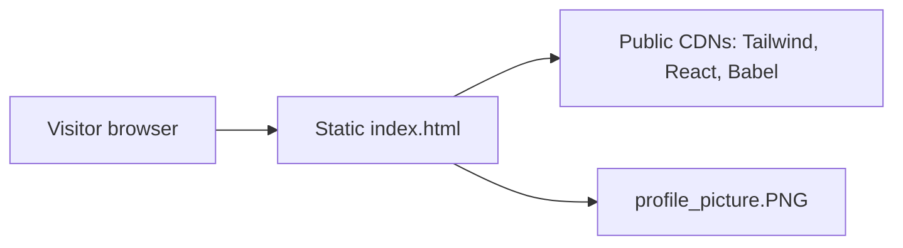
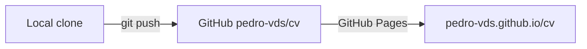
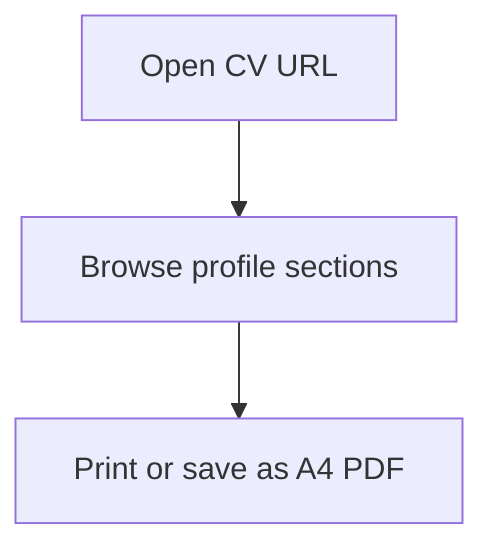

# CV (interactive profile): project overview

> This file mirrors the project note in Pedro's Obsidian vault (`Claude-Brain/Projects/Personal/cv.md`). When hosting, database, auth, repo, connected apps or app type change, update both. No secret values here, only variable names.

## Fact sheet

| Field | Value |
|---|---|
| Purpose | Pedro's interactive online CV and profile page, printable as A4 |
| Status | Live (last commit 2026-04-03) |
| Application type | Web (single static page) |
| Latest change | 2026-04-03: `6b32db3` "On going not to bold" |
| Login / auth | None (public page) |
| Hosting | GitHub Pages: https://pedro-vds.github.io/cv/ (legacy build from branch `main`, folder `/`; not on Vercel) |
| Database | None |
| CDN / storage | Static assets in the repo (`profile_picture.PNG`); libraries from public CDNs (Tailwind, React, Babel via unpkg) |
| Source code | https://github.com/pedro-vds/cv (branch main); local `~/Documents/Claude/Projects/cv/` (moved 2026-11-23, SAG-82) |
| Documentation | Mirror `docs/README.md`; no other docs |
| Stack | One `index.html` (about 53 KB), React 18 UMD, in-browser Babel, Tailwind CDN |
| Connected apps | None |
| Env vars / secrets | None |
| Costs and plan | Free (hosting plan to verify) |
| Linear | SAG-89 (rule), SAG-94 (rollout), SAG-82 (legacy clones) |
| Last reviewed | 2026-11-23 |

## Diagrams

### Architecture

### Deploy flow

### Data model
Not applicable: no database; content is inline in `index.html`.

### User flow

## Description
Single-page interactive CV for Pedro Vieira da Silva, rendered in the browser with React. `cv_old` (branch `cv_v1`) is the superseded copy and is not part of this project. No personal ID numbers or private data should be added to the page or repo.

## How to run it
Live: https://pedro-vds.github.io/cv/. Or open `index.html` in a browser. No build step.

## Change log
- 2026-04-03: certifications dates removed and trainings added (`776fa34`), typo fix (`d746842`), bold styling tweak (`6b32db3`).
- 2026-11-23: clone moved from `Documents/GitHub/cv` to `Documents/Claude/Projects/cv/` (SAG-82); hosting confirmed as GitHub Pages.
- 2026-11-23: note created from the project template; mirror `docs/README.md` to be created by Claude Code (SAG-94).
- 2026-11-23: GitHub Pages source confirmed with `gh api repos/pedro-vds/cv/pages`: branch `main`, folder `/`, legacy build, status built (SAG-105).
- 2026-11-23: docs/README.md mirror created (SAG-105).

## Documentation index

| Path | Content |
|---|---|
| `index.html` (repo root) | The whole page (React, Tailwind and Babel from public CDNs) |
| `profile_picture.PNG` (repo root) | Profile picture used by the page |
